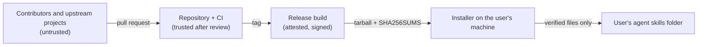

This page argues that Research Agent Skills meets its security requirements. It states the threats, the trust
boundaries and the controls, and links each claim to the evidence a reader can check.

## Security requirements

1. A skill the user installs must not run code or give instructions the maintainers have not reviewed.
2. What a user installs must be exactly what the project published.
3. A skill script must not contact a domain the project has not declared.
4. A vulnerability report must reach the maintainers privately and get a timely response.

## Threat model

| Threat | Asset at risk | Actor |
|---|---|---|
| Prompt injection or hidden instructions in a skill file | The user's agent and the data it can reach | A contributor, or an upstream project we import from |
| Malicious or dangerous code in a skill script | The user's machine and credentials | A contributor, or an upstream project |
| Tampered release, installer or npm package | Every user who installs | An attacker with network or CI access |
| Archive attacks during install (path traversal, links, huge entries) | Files outside the skills folder | A tampered or malicious archive |
| Exfiltration through script network calls | User data and API keys | A malicious script |
| Compromised CI or dependency | The release pipeline | A supply-chain attacker |

## Trust boundaries

Everything that crosses from the left to the repository is untrusted input and is scanned and reviewed. Everything
that crosses to the user is checked again on their machine before anything is written.

## Secure design principles applied

The design follows least privilege, fail-safe defaults, complete mediation and economy of mechanism. The table of
principles and error classes in [SECURITY.md](https://github.com/KalarisLabs/research-agent-skills/blob/main/SECURITY.md)
shows where each one appears in the code and CI.

## Argument and evidence

| Claim | Why it holds | Evidence |
|---|---|---|
| Unreviewed instructions and code do not merge | Every pull request passes spec validation, a prompt-injection and hidden-Unicode lint over all files, the Cisco AI Defense skill scanner, CodeQL, Semgrep, Bandit and secret scanning. Reviewed false positives are pinned and any new finding fails CI. | `tools/validate.py`, `tools/lint_injection.py`, `.github/workflows/skill-security.yml`, `.github/workflows/code-security.yml`, `security/*baseline*.json` |
| Changes to security-sensitive paths get maintainer review | CODEOWNERS covers scripts, `security/`, workflows, installers, CLI and tooling | `.github/CODEOWNERS` |
| Users install what was published | Releases carry SHA-256 checksums, SLSA build provenance and a Sigstore signature. Installers verify the checksum before extracting and stop on a mismatch. | `.github/workflows/release.yml`, `install.sh`, `cli/src/source.ts`, tamper test in `.github/workflows/test.yml` |
| Archive attacks are rejected | The extractor refuses absolute paths, `..`, links and oversized entries. Property-based fuzz tests feed it arbitrary bytes and paths. | `cli/src/tar.ts`, `cli/test/cli.test.mjs`, `cli/test/fuzz.test.mjs` |
| Scripts only reach declared domains | CI fails when a script names a domain missing from the allow-list, and the list needs CODEOWNERS review. | `security/allowed-domains.txt`, `tools/lint_injection.py` |
| The pipeline resists compromise | Actions are pinned by commit SHA, jobs use least-privilege tokens, workflows are linted with zizmor and actionlint, harden-runner audits egress, and Dependabot keeps pins current. | `.github/workflows/`, `.github/dependabot.yml`, OpenSSF Scorecard |
| Vulnerabilities are reported privately and answered | Private vulnerability reporting is on. We acknowledge within 2 business days and fix high or critical issues within 14 days. | `SECURITY.md` |

## Residual risks

- A skill is instructions that an agent follows. Scanning reduces but cannot eliminate the chance that a new
  prompt-injection pattern passes. The mitigation is review by a maintainer, a small allow-listed network surface
  and guidance to run agents with sandboxing and permission prompts.
- Imported upstream skills are reviewed at import time and pinned to a commit, but their authors are outside the
  project. Every re-import runs the same scans.
- The project has a single lead maintainer today. The roadmap lists recruiting domain reviewers and co-maintainers.
